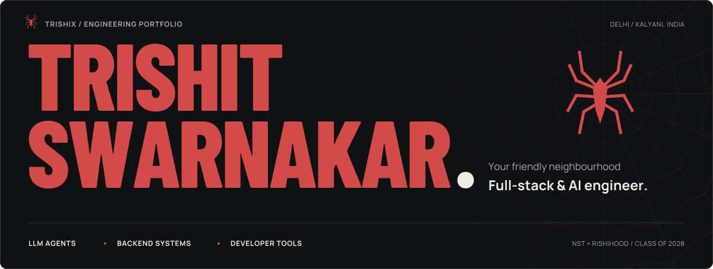
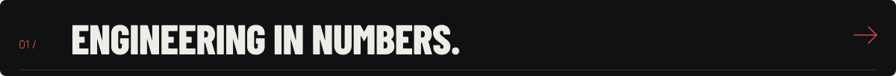
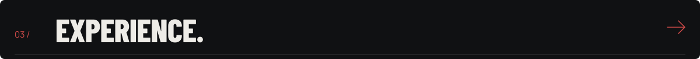
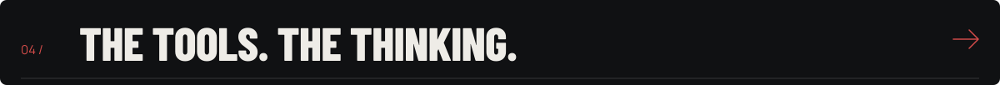
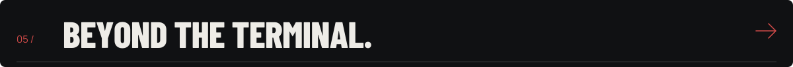

<!-- Upload this README and the assets folder to the root of Trishix/Trishix. -->

  

  
  
  
  

I build **LLM agents, retrieval systems, and full-stack applications**, with a focus on the backend infrastructure that makes them useful and reliable.

Previously an **LLM Research Engineer Intern at Aicoo**, working on evaluations, prompt-injection defenses, and shared agent infrastructure. Studying **B.Tech in Computer Science & Artificial Intelligence** at **Newton School of Technology, Rishihood University** (2024–2028), with a minor in Finance.

<h2></h2>

  
  

  

  
<b>Language breakdown &amp; more coding profiles</b>

   
  

    
  

  
Language percentages describe repository composition, not proficiency. Stats use each provider's reporting window and may be cached.

  

    <a href="https://codeforces.com/profile/trishit_swarnakar">Codeforces</a> ·
    <a href="https://www.hackerrank.com/profile/trishitofficial">HackerRank</a> ·
    <a href="https://github.com/Trishix?tab=repositories">All repositories</a>
  

<h2></h2>

**LLM Research Engineer Intern · Aicoo**  
*June–September 2026 · Remote / Oxford, UK*

- Built evaluation harnesses for LLM behavior, prompt-injection defenses, and output guardrails.
- Prototyped retrieval and agent components; evaluated accuracy and robustness to guide implementation changes.
- Contributed to shared agent infrastructure and agent-to-agent decision-making.

<h2></h2>

| Area | Technologies & practices |
| :--- | :--- |
| **Languages** | Python · TypeScript · JavaScript · SQL · C/C++ |
| **Applications** | React · Next.js · React Native · Tailwind CSS · Node.js · Express |
| **AI & agents** | RAG · embeddings · tool calling · MCP · LangChain · LangGraph · Vercel AI SDK · multi-model orchestration |
| **Backend & data** | PostgreSQL · pgvector · MongoDB · Redis · MySQL · Drizzle ORM · REST APIs · OAuth 2.0 |
| **Reliability** | LLM evaluations · guardrails · schema validation · Jest · Vitest · Playwright · GitHub Actions |
| **Foundations** | DSA · OOP · DBMS · system design · concurrency · TCP/IP · HTTP/HTTPS |

  
<b>Additional tools &amp; coursework</b>

- **Data & ML:** NumPy, Pandas, SciPy, scikit-learn, TensorFlow, Hugging Face.
- **Cloud & networking labs:** AWS VPC, EC2, Security Groups, routing, gateways, and Cloudflare Tunnel.
- **Workflow & design:** Git, Figma, Swagger, n8n, Agile, and Scrum.

<h2></h2>

**Robotics** — Technical Specialist at **SAST / RIT Rover Innovation Team** and former **Vice President, Robotics Club (RU × NST)**. Built ESP32/Arduino subsystems, led CAD and robotics workshops, and contributed to teams competing at IIT Delhi, DTU, and SRM.

**Music & leadership** — Lead guitarist with **10+ years** of experience. Coordinated events at **DAMRU**, including a **10-team Battle of Bands**. Delegate at the Harvard and Asia HPAIR conferences.

  
<b>Community &amp; creative work</b>

- Represented the Robotics Club at Bharat Mandapam during Rishihood's 10th Convocation.
- Co-founded a marketing agency and managed content for GoForGold and Life@Rishihood.

 

  <a href="https://trishitswarnakar.vercel.app">Portfolio</a> ·
  <a href="https://www.linkedin.com/in/trishit-swarnakar/">LinkedIn</a> ·
  <a href="mailto:trishit.swarnakar2024@nst.rishihood.edu.in">Email</a>

